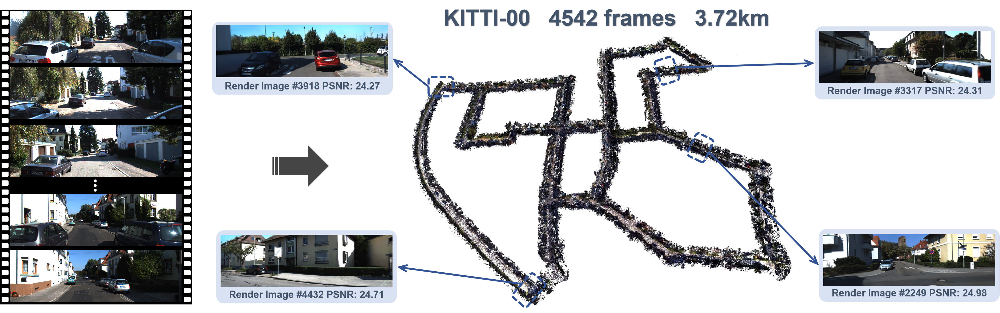
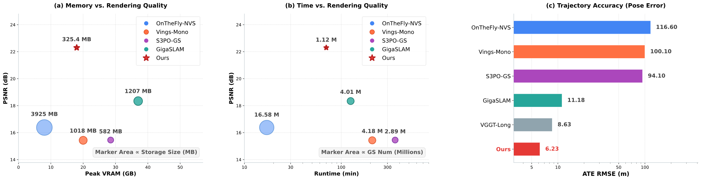
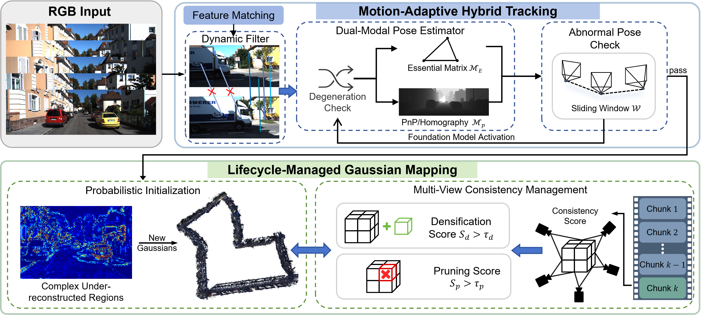

<h1 align="center">Robust and Efficient Monocular 3D Gaussian SLAM<br>for Kilometer-Scale Outdoor Scenes</h1>

<p align="center">
  <strong>Sicheng Yu*</strong> ·
  <strong>Dongxu Shen*</strong> ·
  <strong>Beizhen Zhao</strong> ·
  <strong>Guanzhi Ding</strong> ·
  <a href="https://wanghao.tech/"><strong>Hao Wang✉</strong></a>
</p>

<p align="center">The Hong Kong University of Science and Technology (Guangzhou)</p>

<p align="center">(* Equal Contribution · ✉ Corresponding Author)</p>

<h3 align="center">ECCV 2026</h3>

<p align="center">
  [<a href="https://3dagentworld.github.io/KiloGS-SLAM/">Project page</a>] ·
  [<a href="https://arxiv.org/abs/2606.30436">arXiv</a>]
</p>





<h3 align="center">KiloGS-SLAM supports long outdoor trajectories with accurate camera tracking and Gaussian reconstruction at a low computational cost.</h3>



**Framework of KiloGS-SLAM.** Input RGB frames first undergo sparse matching and dynamic filtering once entering the tracking module. A dual-modal pose estimator dynamically switches between Essential and PnP matrices to handle degeneracies. The estimation is verified against a sliding-window motion prior, triggering an on-demand foundation model dense matching upon failure. Valid poses proceed to the Mapping module. New Gaussians are probabilistically initialized strictly in complex, under-reconstructed regions. During map optimization, chunk-based multi-view consistency scores are evaluated to guide continuous densification and pruning.

⭐ Please also check [S3PO-GS](https://github.com/3DAgentWorld/S3PO-GS) and [OpenGS-SLAM](https://3dagentworld.github.io/opengs-slam/), our early explorations of outdoor Gaussian Splatting SLAM. KiloGS-SLAM extends this direction to longer scenes, more accurate tracking and reconstruction, and lower computational costs.

# Getting started

## Installation

Clone the repository and enter its directory:

```bash
git clone https://github.com/3DAgentWorld/KiloGS-SLAM.git
cd KiloGS-SLAM
```

Ensure `build-essential`, `cmake`, and `libopencv-dev` are available, along with an NVIDIA GPU and the CUDA toolkit. From the repository root:

```bash
conda env create -f environment.yml
conda activate kilogs-slam

# Select your CUDA toolkit installation.
export CUDA_HOME=/usr/local/cuda-11.8
export PATH="$CUDA_HOME/bin:$PATH"

# Install Python dependencies and compile the extensions.
bash scripts/install_kilogs.sh
```

Tested with Ubuntu 20.04, Python 3.10, PyTorch 2.2.0, CUDA 11.8 and an RTX A6000. The installer builds the included FastGS renderer and retrieval modules. See [installation details](docs/INSTALLATION.md) for custom OpenCV paths and extension checks.

## Checkpoints

Download **UniDepth V2 ViT-L**:

```bash
python - <<'PY'
from huggingface_hub import snapshot_download
snapshot_download(
    "lpiccinelli/unidepth-v2-vitl14",
    revision="1d0d3c52f60b5164629d279bb9a7546458e6dcc4",
    local_dir="checkpoints/unidepth-v2-vitl14",
)
PY
```

Set `DepthModel.UniDepthV2.local_snapshot_path` to this directory and keep `from_huggingface: false`.

Hybrid matching also requires [MASt3R](https://github.com/naver/mast3r):

```bash
git clone --recursive https://github.com/naver/mast3r thirdparty/mast3r
git -C thirdparty/mast3r checkout f5209afc300cec36239a7ac992263f36847bbba0
git -C thirdparty/mast3r submodule update --init --recursive
wget https://download.europe.naverlabs.com/ComputerVision/MASt3R/MASt3R_ViTLarge_BaseDecoder_512_catmlpdpt_metric.pth -P checkpoints/
```

Set `tracking.heavy_model.repo_path` and `weights_path` to these locations. Single mode does not load MASt3R. Lightweight feature weights download automatically on first use.

For configurations selecting **Depth Anything 3** (including Waymo 13476), install the [DA3 package](https://github.com/ByteDance-Seed/Depth-Anything-3#-installation) and download the [DA3METRIC-LARGE checkpoint](https://huggingface.co/depth-anything/DA3METRIC-LARGE):

```bash
python - <<'PY'
from huggingface_hub import snapshot_download
snapshot_download("depth-anything/DA3METRIC-LARGE", local_dir="checkpoints/DA3METRIC-LARGE")
PY
```

Set `DepthModel.DepthAnything3.model_path` to the downloaded directory. DA3 is optional for the three examples below; its additional dependencies are separate from the UniDepth environment recipe.

Loop closure uses the ORB vocabulary:

```bash
wget https://github.com/UZ-SLAMLab/ORB_SLAM3/raw/master/Vocabulary/ORBvoc.txt.tar.gz
tar -xzf ORBvoc.txt.tar.gz
```

Set `SLAM.vocab_path` to the extracted file. Loop matching always uses lightweight features, including in hybrid mode.

## Datasets

Download [KITTI odometry](https://www.cvlibs.net/datasets/kitti/eval_odometry.php) and [KITTI-360](https://www.cvlibs.net/datasets/kitti-360/) from their official websites. For Waymo, use the prepared nine sequences linked by [S3PO-GS](https://github.com/3DAgentWorld/S3PO-GS#downloading-datasets).

Set `Dataset.color_path` in each scene YAML to the RGB image folder. KITTI-360 uses the included lists in `configs/KITTI-360/frames/` through `Dataset.index_path` to select frames in order. Keep the supplied camera calibration. For pose evaluation, keep Waymo GT in the sibling `gt/` folder, KITTI poses under `KITTI_stereo/poses/`, and KITTI-360 poses under `KITTI-360/data_poses/`. Set `Dataset.gt_path` to override these locations. Dataset access and reuse remain subject to the original providers' terms.

# Run

Run from the repository root with the environment activated. Each command performs tracking, Gaussian mapping, and color refinement:

```bash
# Waymo 100613
CUDA_VISIBLE_DEVICES=0 python slam.py --config configs/Waymo/waymo_100613.yaml

# KITTI 06
CUDA_VISIBLE_DEVICES=0 python slam.py --config configs/KITTI/kitti_06.yaml

# KITTI-360 0005
CUDA_VISIBLE_DEVICES=0 python slam.py --config configs/KITTI-360/05.yaml
```

## Tracking only

Estimate poses without Gaussian optimization, for example on KITTI 00 with loop closure:

```bash
CUDA_VISIBLE_DEVICES=0 python slam.py --config configs/KITTI/kitti_00.yaml --mode frontend --loop-closure
```

| Argument | Behavior | YAML setting |
|---|---|---|
| `--mode frontend` / `--mode full` | Pose tracking only / complete SLAM | `SLAM.mode` |
| `--loop-closure` / `--no-loop-closure` | Enable / disable loop closure | `SLAM.loop_closure` |
| `--feature-mode hybrid` / `--feature-mode single` | Enable / disable MASt3R fallback | `tracking.feature_mode` |

Arguments override YAML settings. Hybrid uses MASt3R with Essential-matrix pose estimation only when triggered; single incurs no MASt3R loading or inference cost.

## Run all sequences

```bash
bash run_waymo.sh
# Other datasets:
# bash run_kitti.sh
# bash run_kt360.sh
```

Each script uses GPU 0. Edit `SEQS` to select scenes, or run `GPU_ID=2 bash run_waymo.sh` to select another GPU.

Results are saved to `results/<dataset>/<scene>/<timestamp>/`. The batch runner evaluates poses and automatically writes CSVs to `results/summary/`. Rebuild summaries with:

```bash
python summary_result.py --dataset all
```

# Acknowledgements

This implementation builds on [GigaSLAM](https://github.com/DengKaiCQ/GigaSLAM), [S3PO-GS](https://github.com/3DAgentWorld/S3PO-GS), [LightGlue](https://github.com/cvg/LightGlue), [UniDepth](https://github.com/lpiccinelli-eth/UniDepth), [MASt3R](https://github.com/naver/mast3r), and [Depth Anything 3](https://github.com/ByteDance-Seed/Depth-Anything-3). Please retain the included third-party licenses and follow the respective model licenses.

# Citation

If you find our code or work useful in your research, please consider citing the following:

```bibtex
@article{yu2026robust,
  title={Robust and Efficient Monocular 3D Gaussian SLAM for Kilometer-Scale Outdoor Scenes},
  author={Yu, Sicheng and Shen, Dongxu and Zhao, Beizhen and Ding, Guanzhi and Wang, Hao},
  journal={arXiv preprint arXiv:2606.30436},
  year={2026}
}

@article{cheng2025outdoor,
  title={Outdoor Monocular SLAM with Global Scale-Consistent 3D Gaussian Pointmaps},
  author={Cheng, Chong and Yu, Sicheng and Wang, Zijian and Zhou, Yifan and Wang, Hao},
  journal={arXiv preprint arXiv:2507.03737},
  year={2025}
}

@article{yu2025rgb,
  title={Rgb-only gaussian splatting slam for unbounded outdoor scenes},
  author={Yu, Sicheng and Cheng, Chong and Zhou, Yifan and Yang, Xiaojun and Wang, Hao},
  journal={arXiv preprint arXiv:2502.15633},
  year={2025}
}
```
